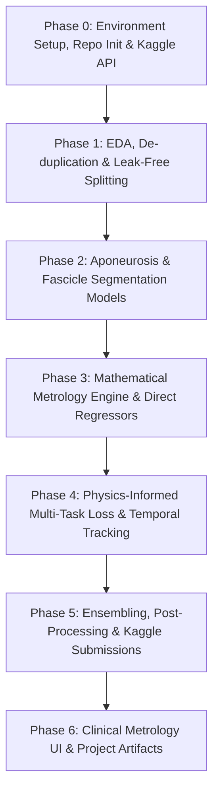

# UMUD Challenge: Muscle Architecture in Ultrasound Data
## Master Strategy, Architectural Blueprint & Phased Execution Plan

---

### Executive Summary

The **Universal Musculoskeletal Ultrasound Database (UMUD) Challenge** on Kaggle targets one of the most critical challenges in clinical biomechanics, sports rehabilitation, and orthopedic diagnostics: **the automated extraction of muscle architecture parameters** from B-mode ultrasound video frames. 

Manual tracing of muscle architectural parameters is labor-intensive, operator-dependent, and prone to intra- and inter-rater variability. This project aims not only to compete at the top of the Kaggle leaderboard but also to build an end-to-end, production-ready, publication-quality biomechanical machine learning framework (**"UltraMuscleAI"**).

```
                      ┌────────────────────────────────────────┐
                      │   Raw B-Mode Ultrasound Image / Frame  │
                      └───────────────────┬────────────────────┘
                                          │
                    ┌─────────────────────┴─────────────────────┐
                    ▼                                           ▼
      ┌───────────────────────────┐               ┌───────────────────────────┐
      │   Path 1: Segmentation    │               │  Path 2: Physics-Informed │
      │   & Geometric Metrology   │               │   Multi-Task Regressor    │
      │ (Aponeurosis + Fascicles) │               │   (ViT / ConvNeXt Backbone)│
      └─────────────┬─────────────┘               └─────────────┬─────────────┘
                    │                                           │
                    │   Spline / RANSAC                         │   PINN Loss
                    │   Fascicle Extrapolation                  │   $MT \approx FL \sin(\theta)$
                    ▼                                           ▼
          [PA_geom, FL_geom, MT_geom]                 [PA_reg, FL_reg, MT_reg]
                    │                                           │
                    └─────────────────────┬─────────────────────┘
                                          ▼
                         ┌─────────────────────────────────┐
                         │   Uncertainty Meta-Learner &    │
                         │   Temporal Kalman / Flow Filter │
                         └────────────────┬────────────────┘
                                          ▼
                         ┌─────────────────────────────────┐
                         │ Final Predictions:              │
                         │ [pa_deg, fl_mm, mt_mm]          │
                         └─────────────────────────────────┘
```

---

### 1. Challenge Definition & Mathematical Metrology Formulation

The challenge asks us to predict three continuous parameters for each ultrasound image/frame:

| Parameter | Symbol | Units | Definition & Anatomical Significance |
| :--- | :---: | :---: | :--- |
| **Pennation Angle** | $\theta_{PA}$ (`pa_deg`) | Degrees ($^\circ$) | Angle between the muscle fascicle trajectory and the deep aponeurosis. Key determinant of force transmission efficiency. |
| **Fascicle Length** | $FL$ (`fl_mm`) | Millimeters ($mm$) | Length of the fascicle between superficial and deep aponeuroses. Directly correlates with maximum contraction velocity and muscle excursion range. |
| **Muscle Thickness**| $MT$ (`mt_mm`) | Millimeters ($mm$) | Perpendicular distance between superficial and deep aponeuroses. Proportional to physiological cross-sectional area (PCSA) and maximum force. |

#### 1.1 The Geometric Inductive Bias (The Physics of Muscle Architecture)
In classical biomechanics, when aponeuroses are approximately parallel and fascicles run linearly between them:
$$\sin(\theta_{PA}) \approx \frac{MT}{FL} \iff FL \approx \frac{MT}{\sin(\theta_{PA})}$$

> [!IMPORTANT]
> **The Extrapolation Phenomenon**: Because standard linear ultrasound probes have limited width (typically 40–60 mm), longer fascicles (e.g., $FL > 70\text{ mm}$ in *Vastus lateralis*) often run off the left and right edges of the field of view (FOV). Expert human raters **extrapolate** the fascicle line until it mathematically intersects the estimated aponeuroses. Standard black-box CNN regressors fail here because they do not understand extrapolation beyond the image border.

#### 1.2 Evaluation Metric: Normalized MAE (UMUD Score)
The evaluation metric is the **UMUD Score**, a normalized mean absolute error across the three parameters:
$$\text{UMUD Score} = \frac{1}{N} \sum_{i=1}^{N} \frac{1}{3} \left[ \frac{|\hat{\theta}_{PA, i} - \theta_{PA, i}|}{T_{PA}} + \frac{|\hat{FL}_i - FL_i|}{T_{FL}} + \frac{|\hat{MT}_i - MT_i|}{T_{MT}} \right]$$
where $T_{PA}$, $T_{FL}$, and $T_{MT}$ are predefined clinical tolerance scales that normalize degrees and millimeters to an equivalent scale. Lower score is better.

---

### 2. Dataset Breakdown & Critical Pitfalls to Solve

The challenge provides a standardized B-mode ultrasound dataset with multi-muscle coverage:
- **Muscles Covered**: *Vastus lateralis*, *Gastrocnemius medialis*, *Gastrocnemius lateralis*, *Tibialis anterior*, and *Rectus femoris* (including healthy and clinical subjects, e.g. cerebral palsy).
- **Fascicle Training Set**: ~2,761 images with annotated fascicle masks/lines.
- **Aponeurosis Training Set**: ~1,048 images with superficial and deep aponeurosis masks.
- **Test Set**: 309 images, containing both static images and consecutive 5-frame video bursts.

#### Critical Data Pitfalls & How We Will Overcome Them:
1. **The 670 Duplicate Image-Mask Pairs**:
   - *Problem*: Community analysis identified 670 exact duplicates in the fascicle training set.
   - *Solution*: Implement perceptual hashing (pHash) and exact tensor MD5 checks to prune duplicate pairs or group them so they never leak across train/validation splits.
2. **Video Sequence Leakage**:
   - *Problem*: Consecutive frames from the same video sequence share identical anatomy, speckle pattern, and depth. Random K-Fold splits will result in severe data leakage and hyper-optimistic local validation scores.
   - *Solution*: Strict **GroupKFold** or **StratifiedGroupKFold** grouped by subject ID / video sequence.
3. **Probe Depth & Pixel-to-Millimeter Calibration**:
   - *Problem*: Ultrasound images vary across probe settings (depth: 30 mm, 40 mm, 60 mm). If pixel scale is not normalized, predicting millimeter outputs ($MT, FL$) directly from pixel coordinates will collapse across different machines.
   - *Solution*: Build an automated scale-bar / depth detector to compute $\text{px\_to\_mm}$ conversion factor for every frame, or condition the model on extracted probe depth metadata.
4. **Discontinuous Aponeuroses & Speckle Noise**:
   - *Problem*: Acoustic shadow and low echo return create gaps in the aponeurosis masks.
   - *Solution*: Morphological closure, spline regression, and active contour models to bridge broken aponeuroses.

---

### 3. Winning Strategy: The Tri-Modal Hybrid Metrology Engine

Top solutions in medical imaging competitions never rely on a single black-box model. The optimal architecture uses a three-pillar hybrid approach:

```
┌─────────────────────────────────────────────────────────────────────────────┐
│                       TRI-MODAL SYSTEM ARCHITECTURE                         │
├─────────────────────────────────────────────────────────────────────────────┤
│                                                                             │
│  [PILLAR 1: Deep Semantic Segmentation & Metrology]                         │
│  • Segment Superficial & Deep Aponeuroses (SegFormer-B4 / ConvNeXt-U-Net)   │
│  • Segment Fascicle Orientations (Vesselness filter + UNet3+ / SAM-2)       │
│  • Post-processing: Polynomial fitting + line intersection extrapolation    │
│  • Yields: Physiologically faithful measurements (geom_PA, geom_FL, geom_MT)│
│                                                                             │
│  [PILLAR 2: Physics-Informed Direct Multi-Task Regressor (PINN-US)]         │
│  • Encoders: Swin-Transformer-V2, ConvNeXt-Large, EfficientNetV2            │
│  • Dual-stream input: Ultrasound image + predicted segmentation mask map    │
│  • Multi-head output: [pa_deg, fl_mm, mt_mm]                                │
│  • Physics-Regularized Loss:                                                │
│      L = L_NMAE + λ_geom * |sin(PA) - MT/FL| + λ_boundary                   │
│                                                                             │
│  [PILLAR 3: Temporal Sequence Consistency & Meta-Ensemble]                  │
│  • Sequence Smoothing: For test sequences (5-frame video chunks), apply     │
│    Kalman filter or Bidirectional GRU / Flow alignment                      │
│  • Meta-Learner: Gradient Boosted Trees (LightGBM/CatBoost) trained on      │
│    Out-Of-Fold (OOF) predictions + image brightness, probe depth, entropy   │
│  • Test-Time Augmentation (TTA) with angle-preserving reflection            │
│                                                                             │
└─────────────────────────────────────────────────────────────────────────────┘
```

---

### 4. Innovation Factors: How to Stand Out & Win

To make this project both a Kaggle winner and a standout portfolio piece:

1. **Physics-Informed Neural Network (PINN) Loss**:
   Standard regressors often predict impossible combinations (e.g., $FL < MT$, or pennation angle incompatible with thickness). We enforce:
   $$\mathcal{L}_{\text{total}} = \mathcal{L}_{\text{Huber}}(\hat{y}, y) + \lambda \cdot \left| \sin\left(\hat{\theta}_{PA} \cdot \frac{\pi}{180}\right) - \frac{\hat{MT}}{\hat{FL}} \right|$$
   This prevents physically unviable hallucinations.

2. **Automated Probe Scale & Tick Metrology**:
   Ultrasound sidebars feature calibration ticks (e.g. 5 mm or 10 mm spacing). We implement a computer vision tick-frequency detector using vertical gradient projection and FFT (Fast Fourier Transform) to dynamically calibrate millimeters per pixel.

3. **SAM-2 (Segment Anything 2) & MedSAM Adaptation**:
   Leverage pretrained medical vision foundation models. Zero-shot / few-shot fine-tune MedSAM or SAM-2 with bounding-box prompts on aponeurosis regions to generate razor-sharp segmentation boundaries even in low signal-to-noise ratio (SNR) regions.

4. **Temporal Optical Flow & Frame-to-Frame Motion Tracking**:
   For the consecutive test frames, tissue moves continuously during muscle contraction. By computing dense Farneback or RAFT optical flow between consecutive frames, we track fascicle motion dynamically, ensuring predictions are smooth and physiologically continuous.

5. **Clinical Metrology Dashboard (Gradio/Streamlit)**:
   Package the winning models into an interactive clinical diagnostic tool:
   - Real-time video playback with live architectural overlays.
   - Visual extrapolation of fascicles to deep and superficial aponeuroses.
   - Live parameter charts ($PA, FL, MT$) over contraction cycles.
   - Export clinical reports in PDF format with confidence intervals.

---

### 5. Detailed Phased Execution Plan

The project is structured into 6 sequential phases. Each phase has concrete deliverables and acceptance criteria.



#### Phase 0: Environment & Workspace Initialization
- Verify GPU availability and install PyTorch with CUDA acceleration.
- Install essential packages: `albumentations`, `segmentation_models_pytorch`, `timm`, `opencv-python`, `scikit-learn`, `lightgbm`, `streamlit`, `scipy`.
- Set up directory structure:
  ```
  umud_project/
  ├── data/
  │   ├── raw/                  # Downloaded competition data
  │   ├── processed/            # Cleaned, deduplicated, grouped splits
  │   └── annotations/
  ├── src/
  │   ├── data/                 # Dataset loaders, Albumentations transforms
  │   ├── models/               # Segmentation models, Regressors, PINN loss
  │   ├── metrology/            # Spline fitting, RANSAC, scale calibration
  │   ├── temporal/             # Optical flow, Kalman filter
  │   ├── training/             # PyTorch training loops, mixed precision, WandB
  │   └── utils/                # Evaluation metric (UMUD Score), helpers
  ├── notebooks/                # Exploratory Data Analysis & visual validation
  ├── submission/               # Kaggle submission scripts and ensembles
  └── app/                      # Interactive clinical Streamlit dashboard
  ```

#### Phase 1: Exploratory Data Analysis (EDA) & Data Curation
- Conduct deep statistical profiling of the labels: distributions of $PA, FL, MT$, aspect ratios, probe depths, muscle groups.
- Execute perceptual hash and MD5 deduplication to eliminate the 670 duplicate fascicle image-mask pairs.
- Implement strict `StratifiedGroupKFold` (5 folds) partitioned by subject/sequence to guarantee zero data leakage.
- Build robust Albumentations ultrasound pipeline:
  - Contrast Limited Adaptive Histogram Equalization (CLAHE) to suppress speckle noise.
  - CoarseDropout / Cutout to simulate acoustic dropouts.
  - Horizontal flip with target adjustment (when flipping horizontally, pennation angle direction is preserved or inverted depending on reference axis).
  - Random brightness, gamma, and mild elastic deformations.

#### Phase 2: Dual Segmentation Model Development
- **Model A: Aponeurosis Segmenter**:
  - Task: Multi-class segmentation (Class 0: Background, Class 1: Superficial Aponeurosis, Class 2: Deep Aponeurosis).
  - Backbones: `SegFormer-B3/B4`, `U-Net` with `timm-efficientnet-b4` and `ConvNeXt-Base`.
  - Losses: Combined `BCEWithLogitsLoss` + `DiceLoss` + `FocalLoss`.
- **Model B: Fascicle Orientation Segmenter**:
  - Task: Segmenting hyperechoic fascicle lines.
  - Architecture: `UNet++` with deep supervision and attention gates.
  - Preprocessing: Frangi vesselness filter / Gabor orientation filters as complementary input channels.

#### Phase 3: Mathematical Metrology Engine & Direct Regressors
- **The Geometric Metrology Pipeline**:
  - From aponeurosis masks: fit 2nd-degree polynomials $y = a x^2 + b x + c$ to trace the superficial and deep aponeuroses.
  - Compute $MT$: average perpendicular distance across valid x-coordinates.
  - From fascicle masks: skeletonize masks, extract linear components via Hough Transform / PCA / RANSAC line fitting.
  - Compute $\theta_{PA}$: acute angle between the fitted fascicle line and the deep aponeurosis tangent.
  - Compute $FL$: calculate Euclidean distance between the intersection points of the fascicle line with both aponeuroses.
- **Direct Multi-Task Regressors**:
  - Train backbones (`ConvNeXt-V2-Tiny/Base`, `EfficientNet-V2-M`, `Swin-T`) directly on raw ultrasound to predict `[pa_deg, fl_mm, mt_mm]` using Huber/SmoothL1 loss.

#### Phase 4: Physics-Informed Multi-Task Network & Temporal Filtering
- Create a dual-input network that feeds both raw ultrasound and predicted aponeurosis/fascicle mask maps into the backbone.
- Incorporate the **PINN Loss**:
  $$\mathcal{L} = \mathcal{L}_{\text{Huber}} + \lambda_{\text{geom}} \left| \sin\left(\hat{\theta} \cdot \frac{\pi}{180}\right) - \frac{\hat{MT}}{\hat{FL}} \right|$$
- Implement temporal filtering for 5-frame video bursts:
  - Bidirectional Kalman filter smoothing across frame sequences.
  - Farneback optical flow tracking to enforce smooth inter-frame parameter transitions.

#### Phase 5: Ensembling, Calibration & Kaggle Submission Pipeline
- **Out-of-Fold (OOF) Stacking**:
  - Train a gradient booster (LightGBM/CatBoost) using predictions from:
    1. Geometric Metrology Engine ($PA_{\text{geom}}, FL_{\text{geom}}, MT_{\text{geom}}$)
    2. Deep ConvNeXt Regressor
    3. Swin Transformer Regressor
    4. Engineered meta-features: predicted aponeurosis curvature, probe depth, mean image intensity, muscle type classifier.
- **Test-Time Augmentation (TTA)**:
  - Multi-scale inference + flip TTA with mathematical angle correction.
  - Generate valid `submission.csv` strictly compliant with `sample_submission.csv` schema (`image_id`, `pa_deg`, `fl_mm`, `mt_mm`).

#### Phase 6: Clinical Metrology UI & Academic/Portfolio Polish
- Develop a Streamlit application featuring:
  - Drag-and-drop ultrasound image/video analysis.
  - Live anatomical segmentation overlays with color-coded aponeuroses and fascicle vectors.
  - Real-time automated calculation of $PA, FL, MT$.
  - PDF diagnostic report generation.
- Produce a clean GitHub repository with reproducible scripts, Dockerfile, benchmark comparisons against baseline tools (DL-Track, SMA), and a comprehensive technical writeup.

---

### 6. Summary Comparison: Standard Approaches vs. Our Master Blueprint

| Feature | Standard Competitor Baseline | Our Master Blueprint |
| :--- | :--- | :--- |
| **Model Type** | Single end-to-end CNN regressor | Hybrid Tri-Modal Engine (Segmentation + Metrology + PINN Regressor) |
| **Data Cleaning** | Uses raw train data as-is | Deduplicates 670 pairs, applies probe scale calibration |
| **Validation** | Random 5-Fold split (data leakage) | Strict Stratified GroupKFold by subject & video burst |
| **Physical Plausibility** | Hallucinates impossible dimensions | Enforces $MT \approx FL \sin(\theta)$ via PINN Loss |
| **Fascicle Extrapolation** | Blindly crops at image edge | Mathematical polynomial & RANSAC ray intersection |
| **Video Sequences** | Treats frames independently | Temporal optical flow & Kalman smoothing |
| **Deliverable** | Simple Jupyter notebook | Kaggle winning pipeline + interactive clinical web app |

---
*Created as part of the UMUD Challenge Master Project Blueprint.*
